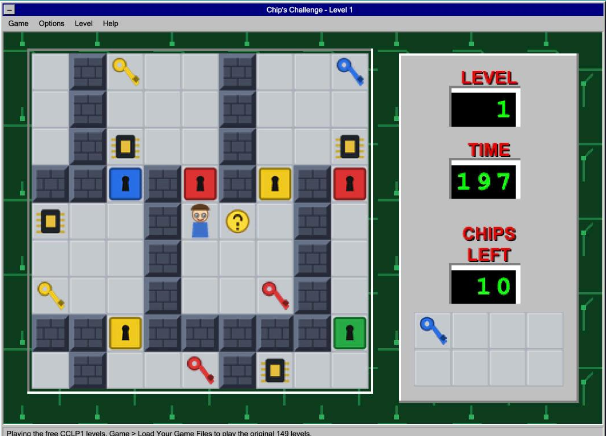
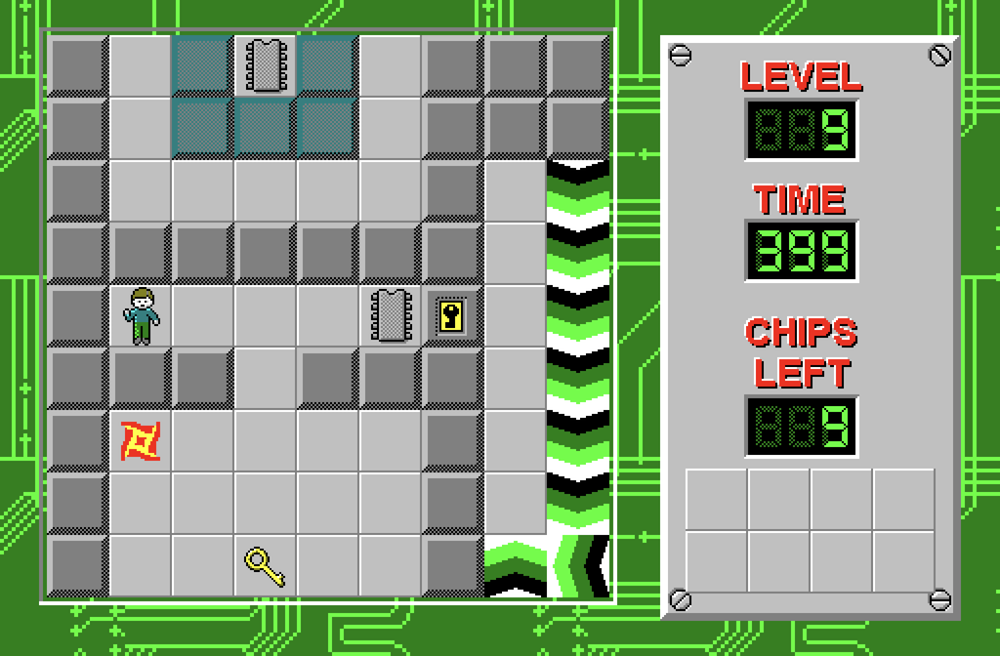

# chips-challenge

Chip's Challenge, the 1992 Windows version, rebuilt from scratch to run in any web browser and as a native Mac app.

The game rules were reverse engineered from the original CHIPS.EXE, so things move, slide, bounce and break the way they did on Windows 3.1. It comes with 149 free community levels and an original tileset, so it plays with nothing else. Load your own copy of the game and you get the original levels, graphics, sounds and music. This repo contains no original game data and never will.



## Play

In a browser: [busflicks.com/chips-challenge](https://busflicks.com/chips-challenge/)

On a Mac: download `ChipsChallenge-mac.zip` from [Releases](https://github.com/GhostInTheBus/chips-challenge/releases), unzip it, and drag `Chip's Challenge.app` to Applications. It's a universal app (Apple Silicon and Intel, macOS 13 or later). The app isn't notarized, so the first time macOS will refuse to open it. Open System Settings, Privacy & Security, scroll down and click Open Anyway. Or run this once:

```sh
xattr -dr com.apple.quarantine "/Applications/Chip's Challenge.app"
```



Arrow keys, WASD or the number pad move Chip. P pauses, R restarts the level. On a phone, swipe on the board or turn on Options, On Screen Arrows.

## Use your own copy

Any copy of Chip's Challenge for Windows works, including the zip from archive.org.

* Web: Game, Load Your Game Files, then pick the zip itself, or CHIPS.DAT and CHIPS.EXE plus the .WAV and .MID files. You can also drop them on the page. The files stay in your browser (IndexedDB); nothing is uploaded.
* Mac: File, Load Game Files, then pick the folder, the zip, or the files. They're copied to `~/Library/Application Support/Chips Challenge`.

Then switch with Options, Original Levels. Progress, passwords and best times are kept separately for each level set.

| | free mode | with your copy |
|---|---|---|
| levels | CCLP1, 149 community levels | the original 149 |
| graphics | new tileset drawn for this project | the originals, read out of CHIPS.EXE |
| sound | simple generated sounds | the original .WAV files |
| music | none | CHIP01.MID and CHIP02.MID |

## How it was made

Short version, details in [docs/TIL.md](docs/TIL.md):

* `web/js/formats.js` reads CHIPS.DAT and pulls the tile sheet, side panel, LED digits and ending picture out of CHIPS.EXE, a 16 bit Windows executable. See [docs/FORMATS.md](docs/FORMATS.md).
* `web/js/engine.js` is the game. It follows the original's logic routine by routine (DoTick, MoveChip, MoveBlock, MoveMonster, MonsterLoop, SlipLoop and the rest), worked out from the community disassembly of CHIPS.EXE. Every rule and the place it came from is in [docs/RULES.md](docs/RULES.md).
* The web page (`web/`) and the Mac app (`mac/`) both run that same engine file. The Mac app is native AppKit: drawing, menus, keyboard, sound effects and MIDI music are all macOS; the rules run in JavaScriptCore.

## Build it yourself

Web: there's nothing to build. Serve the `web` folder with any static server.

```sh
cd web && python3 -m http.server 8000
```

Mac (needs the Xcode command line tools):

```sh
bash mac/build.sh          # build/Chip's Challenge.app
bash mac/build.sh --zip    # also build/ChipsChallenge-mac.zip
```

## Tests

No dependencies, just Node.

```sh
node test/mechanics.js                    # one tiny level per rule, 45 checks
node test/fuzz.js web/levels/CCLP1.dat    # random play on every level, checks invariants
node test/solve.js path/to/CHIPS.DAT 3,5,7  # a solver finishes real levels using only the engine
node test/route.js path/to/CHIPS.DAT 1 "WWNSS..."  # play a level from a move list
```

## Docs

* [docs/TIL.md](docs/TIL.md) what I learned building this
* [docs/ELI5.md](docs/ELI5.md) the whole thing explained simply
* [docs/FORMATS.md](docs/FORMATS.md) CHIPS.DAT, CHIPS.EXE resources, tile ids, sounds, music
* [docs/RULES.md](docs/RULES.md) the game rules as read from the disassembly, with line references

## Credits and legal

* Chip's Challenge was created by Chuck Sommerville. This project is not affiliated with or endorsed by its rights holders. To play the original levels you need your own copy of the game.
* [magical/CHIPS.EXE](https://github.com/magical/CHIPS.EXE), the commented disassembly this engine's rules come from.
* [CCLP1](https://bitbusters.club/cclp1/), Chip's Challenge Level Pack 1, by the Chip's Challenge community at the Bit Busters Club. Included unmodified, as its readme allows. See [web/levels/README.md](web/levels/README.md).
* [Tile World](https://github.com/BR903/tworld) and [Lexy's Labyrinth](https://github.com/eevee/lexys-labyrinth) for showing it can be done. No code from either is used here.
* The free tileset and the app icon are drawn from code in `tools/` and are part of this repo.
* Code in this repo is MIT licensed, see [LICENSE](LICENSE).
